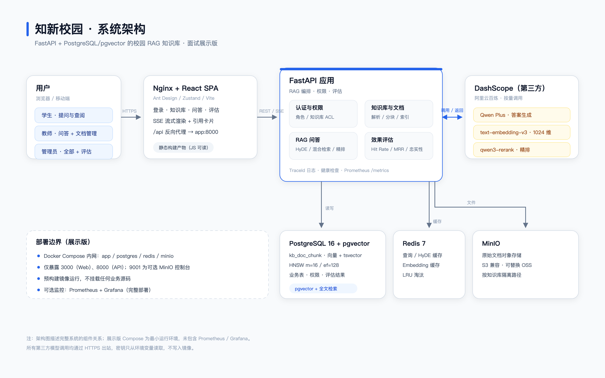
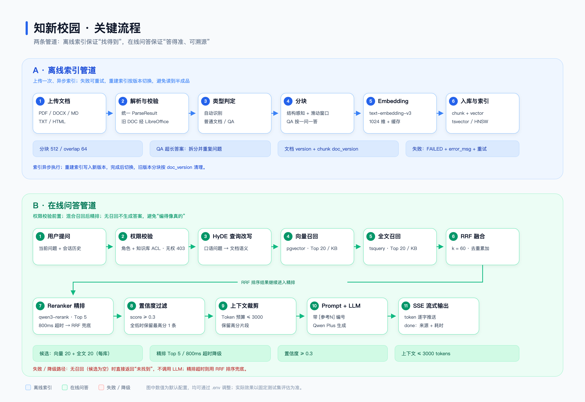

# 项目案例：知新校园 · 智能知识库（RAG）

> 本文是面试展示版的项目案例说明，覆盖职责、技术难点、指标口径、个人贡献和已知局限。
>
> **指标说明：** 截至 2026-10-21，项目的 50 题评估集尚未完成期望 Chunk 标注，因此本文不提供未经实测的 Hit Rate / MRR / 延迟数字。第 5 节给出可复现的评测协议和待填写的表格；面试时应如实说明“链路已实现、指标待补测”，不要引用未经本机验证的数字。

---

## 1. 项目概览

**一句话：** 一个面向校园规章、办事指南和课程资料的 RAG 知识库，支持多格式文档入库、混合检索、重排序、带引用的流式问答、角色与知识库级权限隔离，以及可复现的检索效果评估。

### 1.1 业务背景

校园文档有三个典型问题：

1. **分散**：制度、办事指南、培养方案、课程资料分布在不同系统和 PDF 中。
2. **难查**：学生不知道文件叫什么、在哪一章，搜索关键词和正式表述经常对不上。
3. **不敢信**：直接让大模型回答，可能出现“看起来很像、但制度里没有”的内容；没有引用就无法核实。

### 1.2 目标与非目标

| 目标 | 非目标 |
| --- | --- |
| 文档统一入库，支持常见办公格式 | 不做通用搜索引擎 |
| 回答必须带可核实的来源 | 不做开放式闲聊 |
| 普通文档与 QA 文档分别优化分块 | 不做文档自动撰写 |
| 按角色和知识库授权隔离 | 不做完整的企业 SSO / 多租户 SaaS |
| 用固定测试集量化检索效果 | 不在展示版中提供完整业务源码 |

### 1.3 用户与权限

| 角色 | 能力 |
| --- | --- |
| 学生（STUDENT） | 提问、查看被授权或公开的知识库 |
| 教师（TEACHER） | 提问、管理被授权知识库的文档 |
| 管理员（ADMIN） | 全部功能，包括知识库配置、效果评估和监控 |

---

## 2. 我的职责与个人贡献

### 2.1 负责范围

| 模块 | 具体工作 |
| --- | --- |
| 文档解析 | PDF / DOCX / DOC / Markdown / TXT / HTML 解析；旧版 DOC 经 LibreOffice 转 DOCX；统一解析结果，保留页码与章节信息 |
| 分块 | 普通文档的结构感知 + 滑动窗口分块；QA/FAQ 文档按“一问一答”分块；超长答案拆分后重复问题；QA 格式校验报告 |
| 检索 | pgvector 向量检索 + PostgreSQL 全文检索双路召回；RRF 融合与去重；HyDE 假设答案召回 |
| 精排与生成 | Reranker 精排、800ms 超时降级、置信度过滤、Token 预算裁剪、引用编号与来源组装 |
| 问答链路 | 同步 / SSE 流式问答、多轮会话、会话隔离、查询缓存 |
| 权限 | 学生 / 教师 / 管理员角色；知识库 USER / DEPARTMENT ACL；请求入口逐库校验 |
| 评估 | Hit Rate / MRR / Faithfulness 评估流水线；Chunk 标注；按评估版本对比 |
| 部署 | 前后端多阶段镜像、Docker Compose 编排、健康检查、TraceId 日志、Prometheus 指标 |

### 2.2 复用与第三方组件（建议在面试中主动说明）

| 部分 | 来源 / 边界 |
| --- | --- |
| 前端页面 | 基于开源管理端模板修改，保留其布局与组件风格，按项目需求调整页面和交互 |
| 大模型 | 阿里云百炼 DashScope：Qwen Plus（生成）、text-embedding-v3（Embedding）、qwen3-rerank（精排） |
| 向量与全文检索 | PostgreSQL 16 + pgvector + 原生全文检索，没有自研向量数据库 |
| 认证 | 演示实现：账号写死、token 存在进程内；生产应接 SSO / LDAP 和 Redis |
| 参考实现 | 项目的 RAG 分层与部分设计思路参考了课程 / 开源资料；本项目中的校园化改造、接口实现、部署和评估工作由本人完成 |

> **写作提示：** 上表最后一行请按你的真实情况调整。明确说出“哪些是复用的、哪些是自己写的”，比笼统声称“从零自研”更可信；面试官通常会顺着架构追问取舍，而不是数代码行数。

### 2.3 可直接使用的贡献表述

> 我负责校园知识库 RAG 系统的后端与部署：完成多格式文档解析与分块、pgvector + PostgreSQL 全文检索的混合召回、RRF 融合、Reranker 精排、引用溯源与 SSE 流式问答；设计学生 / 教师 / 管理员角色和知识库 ACL；搭建 Hit Rate / MRR / Faithfulness 评估流水线，并完成 Docker Compose 化部署。前端页面基于开源模板修改，模型与向量数据库使用第三方服务。

如果某部分不是独立完成，把“负责”改成“参与”，并说清楚自己实际改了什么。不要为了显得完整而扩大范围。

---

## 3. 架构与两条管道



### 3.1 离线索引管道

```text
上传文档
  → 解析（PDF / DOCX / DOC / MD / TXT / HTML）
  → 统一 ParseResult，保留页码与章节
  → 文档类型判定（AUTO / NORMAL / QA）
  → 分块（结构感知 + 滑动窗口 / QA 问答对）
  → Embedding（text-embedding-v3，1024 维）
  → 入库（Chunk 正文 + 向量 + tsvector）
  → 状态 DONE / FAILED，失败可重试
```

关键点：

- 原始文件存 MinIO，数据库只存对象路径和 Chunk，不把大文件塞进数据库。
- 文档有 `version`，Chunk 有 `doc_version`；重建索引写入新版本，完成后切换，旧版本按版本号清理。
- 索引异步执行，前端轮询状态；失败记录 `error_msg`，支持重试。

### 3.2 在线问答管道

```text
用户提问
  → 权限校验（角色 + 知识库 ACL，无权直接 403）
  → HyDE 生成假设答案
  → 向量召回 Top 20 / KB + 全文召回 Top 20 / KB
  → RRF 融合（k=60，按 chunk id 去重累加）
  → Reranker 精排 Top 5（800ms 超时回退 RRF 顺序）
  → 置信度过滤（score ≥ 0.3）
  → 上下文裁剪（≤ 3000 tokens）
  → 带 [参考N] 编号的 Prompt + Qwen Plus
  → SSE：status → token → done（sources + latency_ms）
```



---

## 4. 关键难点与设计取舍

### 4.1 多格式解析：先统一，再谈分块

**问题：** 不同格式的解析结果差异很大。PDF 有页码但表格容易散，DOCX 有标题层级，旧版 DOC 需要转换，HTML 有标签噪声。

**方案：**

- 每种格式实现独立 loader，最终统一成 `ParseResult`（正文 + 页码 + 章节 + 元信息）。
- 旧版 `.doc` 先经 LibreOffice 转 `.docx`，再走 DOCX 解析。
- 页码和章节标题一路带到 Chunk，供引用溯源使用。

**取舍：**

- 不做 OCR，扫描版 PDF 需要先 OCR。
- 表格主要按文本行处理，复杂表格结构会丢失；没有引入版面分析模型。
- 解析失败会明确标记 FAILED，而不是静默生成空内容。

**可验证点：** 上传不同格式的同一份制度文件，对比 Chunk 的 `page_num`、`section_title` 和正文完整性。

### 4.2 双分块：普通文档和 QA 文档不能用同一套切法

**问题：** 固定窗口分块会把“问题”和“答案”切到两个 Chunk 里；检索到答案片段时，模型看不到它回答的是哪个问题。

**方案：**

- 普通文档：结构感知优先（按标题 / 段落），超长段落用滑动窗口（512 字符，重叠 64）。
- QA 文档：识别 `Q:` / `A:`、`问题：` / `答案：`、Markdown 二级标题等格式，一问一答生成一个 Chunk。
- 答案超过约 1200 字符时按段落拆分，每个子 Chunk 重复携带问题。
- 生成 QA 校验报告：空问题、缺答案、短答案、重复问题、无法识别的正文。

**取舍：**

- QA 模式依赖格式规范；严重格式错误会阻止索引，避免“看起来成功、实际切错”。
- 没有使用语义分块模型，分块边界仍以结构和长度为主。
- 滑动窗口会产生一定冗余，但能保证跨段落的上下文连续。

**可验证点：** 查看 QA 报告计数；在 Chunk 窗口检查每个 QA Chunk 是否同时包含问题和答案；对比普通模式和 QA 模式的切分结果。

### 4.3 混合检索：向量和全文各管一段

**问题：**

- 向量检索擅长语义相近，但对课程编号、专有名词、数字、条款号等精确词不敏感。
- 全文检索擅长精确词，但对口语化改写无能为力。

**方案：**

- 每个知识库分别做向量 Top 20 和全文 Top 20。
- 用 RRF 融合：`score = Σ 1 / (k + rank)`，`k = 60`；同一 Chunk 出现在两路时分数累加。
- 按 `chunk.id` 去重，按 RRF 分数降序取 Top N。

**取舍：**

- RRF 只看排名，不看原始分数，天然规避了余弦相似度和 BM25 分数不可比的问题；代价是丢失了绝对置信度信息。
- 每个知识库单独取 Top K，知识库数量多时可能放大候选集；当前通过权限前置和 RRF 截断控制规模。
- 中文全文检索使用 PostgreSQL `simple` 配置，没有接中文分词插件，因此全文召回主要作为精确词补充，主力仍是向量召回。

**可验证点：** 日志会分别打印向量召回数、全文召回数和融合后条数；用同一个问题对比“只看向量”和“混合检索”的 Top 结果。

### 4.4 HyDE：让问题和文档“说同一种话”

**问题：** 学生问“钥匙忘带了咋办”，制度写的是“学生因特殊情况可凭有效证件借用本宿舍钥匙”。问题短、口语化，和文档正文的语义距离较大。

**方案：**

- 先用 LLM 生成 2–4 句假设性回答，再对假设回答做 Embedding 检索。
- 原始问题的混合检索结果与 HyDE 向量检索结果再做一次 RRF 融合。
- HyDE 结果带 10 分钟 Redis 缓存；生成失败时降级为原始问题。

**取舍：**

- 多一次 LLM 调用，增加延迟和成本；缓存只能缓解重复问题。
- 假设答案可能“编造”，所以只把它当成检索桥梁，不作为最终答案。
- 代码里另有 `expand_query` 多路扩展方法，但当前主链路没有接入；面试时不要把它说成已生效的能力。

**可验证点：** 日志中的 `HyDE-生成假设答案(LLM)` 和 `HyDE-假设答案向量检索` 两段计时；清空缓存后对比同一问题的召回结果。

### 4.5 精排与降级：精度和可用性要同时考虑

**问题：** Embedding 检索是 Bi-Encoder，快但粗；Reranker 是 Cross-Encoder，准但慢，而且依赖外部 API。

**方案：**

- 对 RRF 融合后的候选调用 qwen3-rerank，精排后取 Top 5。
- 设置 800ms 超时；超时或 API 失败时按 RRF 分数截取 Top N，整条链路不崩。
- 记录 Reranker 的 token 消耗，便于成本观察。

**取舍：**

- 精排上限 5 条是“精度 / 延迟 / 上下文成本”的折中；候选更多不一定更好，因为最终要放进 3000 token 预算。
- 超时阈值在弱网或跨地域部署时可能需要调大；当前默认值适合本地 / 同区域调用。
- 没有本地 reranker 兜底。

**可验证点：** 临时填错 Reranker 地址或把超时调到极小值，观察日志中的降级告警和仍然返回的答案。

### 4.6 置信度过滤与上下文裁剪：不是“有召回就一定生成”

**问题：** 召回结果里可能混入低相关 Chunk；全部塞进 Prompt 会挤爆 Token 预算，也会干扰生成。

**方案：**

- 过滤精排分数低于 0.3 的 Chunk。
- 如果全部低于阈值，保留最高分的 1 条，避免“完全没有上下文”。
- 按分数从高到低贪心加入 Chunk，直到 3000 token 预算耗尽；第一个 Chunk 就超预算时按句子边界截断。

**取舍：**

- 这是**软过滤**，不是“低置信就拒答”。如果所有结果都低分，系统仍会基于最高分片段生成答案；如果希望严格拒答，需要额外增加“答案可回答性”判断或硬阈值。
- 0.3 是经验阈值，和具体 Reranker 的分数分布有关，换模型后需要重新校准。
- 裁剪按分数贪心，可能丢掉排在后面但信息互补的片段。

**可验证点：** 用无关问题提问，观察返回内容；查看日志中的 `ContextTrimmer` 选取条数和 token 使用量。

### 4.7 引用溯源与防幻觉：让答案可以被核实

**问题：** 大模型可能给出“制度里没有”的细节；没有来源，用户无法判断。

**方案：**

- 上下文按 `[参考1] [参考2] …` 编号，Prompt 要求模型在关键陈述后标注引用。
- 生成后用 CitationParser 解析引用编号，SourceBuilder 关联文档名、页码、章节和摘要。
- 模型没有标注引用时，退化为“所有参与生成的 Chunk 都列为来源”，避免来源为空。
- 同步管道对约 20% 的请求抽样做 LLM 忠实性检测，不通过只记警告，不阻断返回。

**取舍：**

- 引用解析是规则匹配，模型引用格式不标准时可能漏解析；兜底会列出全部来源，但不等于每一句都有精确出处。
- 幻觉检测是**抽样监控**，不是逐句校验，也没有接入流式主链路；流式问答主要依靠引用溯源。
- 忠实性检测本身也是一次 LLM 调用，有成本和误判。

**可验证点：** 提问后检查 `done` 事件中的 `sources`；对照文档原文核实引用；在日志中搜索“幻觉检测不通过”。

### 4.8 流式、多轮与评估隔离

**问题：**

- 生成需要数秒，同步返回体验差。
- 多轮对话需要历史，但评估时复用会话会把上一题的问答带进下一题，污染指标。

**方案：**

- SSE 三段式：`status`（检索中 / 生成中）→ `token`（逐字）→ `done`（来源 + 耗时），异常发 `error`。
- 只在首轮（无历史）启用查询缓存；多轮追问不走缓存。
- 评估每题使用一次性 UUID 会话，避免历史污染。
- 会话归属校验：读取会话消息前确认当前用户是会话所有者。

**取舍：**

- token 存在单进程内存中，多 worker / 多副本会失效；生产要迁到 Redis。
- SSE 在 Nginx 后必须关闭缓冲，否则首包出不来。
- 查询缓存和 HyDE 缓存会显著影响延迟测量；做基准测试时要先清缓存或使用不同问题。

**可验证点：** `curl -N` 直接观察 SSE 事件顺序；用同一会话连续追问，检查历史是否带入；在评估结果中确认每题会话 ID 不同。

### 4.9 权限隔离：前端隐藏菜单不等于安全

**问题：** 如果只在页面上隐藏“人事制度”知识库，用户仍然可以直接调 API 传入 `kb_id`。

**方案：**

- 角色校验（学生 / 教师 / 管理员）+ 知识库 ACL（USER / DEPARTMENT）。
- 同步问答、流式问答、知识库接口在入口处逐库调用 `require_read`；文档管理调用 `require_write`；知识库配置和评估调用 `require_admin`。
- 检索服务另有一个 `retrieve_with_permission_check` 兜底方法，支持“部分无权时静默剔除、全部无权时 403”。

**取舍：**

- 当前完整问答管道（`FullRagPipeline` / `StreamingRagService`）主要依赖 Controller 层的 `require_read`；`retrieve_with_permission_check` 已实现但**尚未接入主链路**。如果新增入口忘记调用权限校验，服务层兜底不会自动生效。这是后续要补的防线。
- 当前权限校验是“任一请求知识库无权就整体 403”，不是“剔除无权库、继续查有权库”；后者是 `retrieve_with_permission_check` 的行为，尚未启用。
- 演示账号写死，生产必须换正式认证。

**可验证点：** 用 `student001` 登录后直接调用 API，传入只有 HR 部门可见的 `kb_id`，观察 403；对比 `admin` 的返回。

### 4.10 效果评估：没有 ground truth 就不能谈提升

**问题：** 改了分块、检索或 Prompt 之后，怎么判断是变好还是变差？

**方案：**

- 固定评估题集：问题 + 参考答案 + 期望命中的 Chunk ID。
- 每题检索 + 精排，判断期望 Chunk 是否出现、排第几，计算 Hit Rate 和 MRR。
- 对带参考答案的题生成回答，调用忠实性检查，计算 Faithfulness。
- 结果按 `eval_version` 落库，支持按版本对比。
- 提供 Chunk 搜索与标注界面，按关键词搜索完整 Chunk 正文，人工勾选期望项。

**取舍：**

- 评估效果高度依赖标注质量；未标注 `expected_chunk_ids` 时，Hit Rate / MRR 会被计为 0。
- 当前评估的命中判定在精排 Top-10 内（`RERANK_TOP_K=10`），而在线生成使用 Top-5；两者口径不同，不能把评估结果直接说成“Top-5 召回率”。
- 评估每题都会调用检索和模型，题量大时耗时和成本较高。
- 忠实性由 LLM 判定，存在模型偏差。

**可验证点：** 在评估页面查看 `expected_chunk_ids` 为空和已标注两种情况下的结果差异；检查 `kb_eval_result` 表中的 `hit`、`rank`、`faithfulness` 字段。

### 4.11 部署：先保证能起来，再保证不泄密

**问题：** 本地能跑不等于换台机器能跑；镜像里容易混进 `.env`、测试数据和真实文档。

**方案：**

- 前后端多阶段构建：后端只复制 `src` 和安装好的依赖；前端只把构建产物复制到 Nginx。
- `.dockerignore` 排除 `.env`、`.git`、测试目录、虚拟环境等。
- Compose 统一网络，数据库 / Redis / MinIO 不映射到宿主机；只暴露 Web 和 API。
- 健康检查覆盖 DB、Redis、MinIO；应用镜像内置 `curl`。
- 固定基础镜像和中间件版本，避免 `latest` 漂移。
- 所有密钥通过环境变量注入，不写进镜像层。

**取舍：**

- 后端镜像是 Python 源码运行，镜像内仍能看到 `src/`；预构建镜像只能避免“仓库直接给源码”，不能防止有权限的人解包。源码敏感时必须用私有镜像仓库。
- 应用容器当前以 root 运行，没有切换非 root 用户；生产应补。
- 没有 CI / SBOM / 镜像签名，发布流程仍是手工。
- 数据库初始化脚本只在空卷首次启动时执行，没有正式迁移工具。

**可验证点：** `docker history`、`docker run ... ls /app`、`docker compose config`；检查镜像内没有 `.env`。

---

## 5. 效果评估：口径、现状与待补数据

### 5.1 当前数据集的真实状态

完整源码仓库中的评估集为 `eval_dataset_v1.jsonl`：

| 项目 | 数值 |
| --- | ---: |
| 总题数 | 50 |
| 知识库数 | 5 |
| 每个知识库题数 | 10 |
| `dev` | 40 |
| `holdout` | 10 |
| easy / medium | 25 / 25 |
| 已标注期望 Chunk 的题数 | **0** |
| `review_status` | 全部 `pending_chunk_annotation` |

**结论：目前没有可复现的 Hit Rate / MRR 基线。** 在 `expected_chunk_ids` 补齐前运行评估，命中会被判为 false，指标没有解释力。

### 5.2 指标定义与代码口径

| 指标 | 定义 | 代码口径 |
| --- | --- | --- |
| Hit@K | 期望 Chunk 是否出现在精排 Top-K 中 | 命中题数 / 总题数 |
| MRR@K | 首个正确 Chunk 的倒数排名 | 每题 `1/rank`，未命中计 0；对**总题数**求平均（不是只对命中题平均） |
| Faithfulness | 答案相对上下文的忠实程度 | 对带参考答案的题调用 LLM 判定，取已评估题的平均 |

**重要的口径差异：**

- 评估服务使用 `CANDIDATE_TOP_K=20`、`RERANK_TOP_K=10`，所以当前指标严格说是 **Hit@10 / MRR@10**。
- 在线问答使用 `RERANKER_TOP_N=5` 生成上下文，所以“在线看到 5 条来源”不等于“Top-5 召回率”。
- 如果面试要讲 Top-5，必须先把评估常量改成 5，或在评估脚本中单独计算 Top-5，并保留两套口径的记录。

### 5.3 标注流程

1. 确认当前索引版本（文档已完成索引，Chunk 不再变化）。
2. 在“效果评估”中新增或编辑问题，填写问题、参考答案、来源文档和定位提示。
3. 点击“标注”，输入关键词搜索完整 Chunk 正文。
4. 勾选一个或多个期望 Chunk，保存 `expected_chunk_ids`。
5. 把 `review_status` 从 `pending_chunk_annotation` 改为 `approved`。
6. 用固定的 `eval_version` 运行评估，例如 `v1_chunk512_hybrid`。
7. 重建索引或修改分块参数后，Chunk ID 会变化，必须重新标注或重新映射。

### 5.4 对照实验设计（待执行）

要回答“混合检索 / 精排到底有没有用”，需要至少四个可切换的配置。**当前代码没有暴露这些开关，以下是建议在完整源码仓库中补的实验设计，不是已经完成的结果。**

| 版本 | 配置 | 目的 |
| --- | --- | --- |
| B0 | 仅向量召回，不精排 | 基线 |
| B1 | 向量 + 全文 + RRF | 看混合召回增益 |
| B2 | B1 + HyDE | 看查询改写增益 |
| B3 | B2 + Reranker | 看精排增益 |

执行要求：

- 固定测试集、索引版本、模型版本和评估脚本。
- 用 `dev` 调参，用 `holdout` 做最终验证，避免在 holdout 上反复调。
- 每个版本用不同的 `eval_version` 落库，保留原始逐题结果。
- 报告 Hit@K、MRR@K 时同时给出 K、题数、标注状态和置信区间（如需要）。
- 延迟单独测，不要和检索质量混在一张表里。

### 5.5 延迟测量口径

| 指标 | 定义 | 测量方式 |
| --- | --- | --- |
| TTFT | 从发起请求到收到第一个 `token` 事件 | 客户端记录第一个 token 的时间戳 |
| 端到端总耗时 | 从发起请求到 `done` 事件 | SSE `done` 中的 `latency_ms`，或客户端总耗时 |
| p50 / p95 | 中位数 / 95 分位 | 至少 20 次有效请求，剔除失败和缓存命中 |

测试前必须注意：

- **清理 Redis 查询缓存和 HyDE 缓存**，或使用不同问题；缓存命中时 `latency_ms` 可能为 0，会严重拉低均值。
- 固定模型、地域、网络和并发；记录是否走公网、是否跨地域。
- 区分冷启动和热稳定状态；首次调用包含连接建立和模型侧冷启动。
- 记录机器配置、Docker 资源限制、镜像版本和测试时间。

### 5.6 指标记录表（待实测）

> 以下数值全部留空。完成标注和对照实验后，把真实结果填进来；**不要用示例数字代替实测。**

| 指标 | 基线 B0 | 优化后 B3 | 变化 | 计算口径 | 样本量 | 数据来源 |
| --- | ---: | ---: | ---: | --- | ---: | --- |
| Hit@10 | 待实测 | 待实测 | — | 期望 Chunk 在精排 Top-10 | 40 dev / 10 holdout | `kb_eval_result` |
| MRR@10 | 待实测 | 待实测 | — | 未命中计 0，对总题数平均 | 40 / 10 | `kb_eval_result` |
| Faithfulness | 待实测 | 待实测 | — | LLM 判定均值 | 带参考答案的题 | `kb_eval_result` |
| TTFT p50 | 待实测 | 待实测 | — | 首 token 时间 | ≥ 20 次 | 客户端埋点 |
| TTFT p95 | 待实测 | 待实测 | — | 首 token 时间 | ≥ 20 次 | 客户端埋点 |
| 端到端 p50 | 待实测 | 待实测 | — | `done` 事件耗时 | ≥ 20 次 | SSE / 日志 |

### 5.7 可验证的工程参数（不是效果结论）

这些是代码和配置里的事实，面试时可以直接解释：

| 参数 | 值 | 位置 |
| --- | ---: | --- |
| 普通分块大小 / 重叠 | 512 / 64 | `.env` |
| 向量召回 Top K（每库） | 20 | `.env` |
| 全文召回 Top K（每库） | 20 | `.env` |
| RRF 平滑参数 k | 60 | `retrieval.py` |
| 在线精排 Top N | 5 | `.env` |
| Reranker 超时 | 800 ms | `.env` |
| 置信度阈值 | 0.3 | `.env` |
| 上下文 Token 预算 | 3000 | `.env` |
| Embedding 维度 | 1024 | `schema.sql` |
| HNSW 参数 | m=16, ef_construction=128 | `schema.sql` |
| 评估候选 / 精排 | 20 / 10 | `eval_service.py` |
| 上传限制 | 50 MB / 100 MB | `.env` |
| 索引重试次数 | 3 | `schema.sql` |
| SSE 事件 | status / token / done / error | `streaming_rag_service.py` |

### 5.8 面试表述模板

完成实测后，可以这样讲：

> 在固定的 50 题校园问答测试集上（5 个知识库 × 10 题，40 题 dev、10 题 holdout），以当前索引版本人工标注期望 Chunk 后，按精排 Top-K 判定命中：Hit@K 为 `__%`，MRR@K 为 `__`。测试环境为 `__`（CPU / 内存 / 操作系统 / Docker 版本 / 模型服务地域），每个指标 `__` 次有效请求，报告 p50 和 p95。TTFT p50 为 `__ ms`，端到端 p50 为 `__ ms`。

如果还没测，直接说：

> 评估流水线已经落地，但 50 题的期望 Chunk 标注还没完成，所以目前没有可信的 Hit Rate / MRR 数字。我的评测口径是 `__`，补测计划是 `__`。

**不要这样说：**

- “检索准确率 85%” —— 没定义“准确率”是 Hit Rate 还是答案正确率，也没有样本量。
- “性能提升 50%” —— 没有基线、测试环境和计算方式。
- “从零实现” —— 如果用了模板、课程参考或第三方组件，面试官追问细节时很难圆。
- “生产级” —— 当前认证、限流、备份和迁移都还是演示级。

---

## 6. 面试演示脚本（5–10 分钟）

### 0–1 分钟：问题和架构

- 一句话说明业务问题：校园文档分散，学生需要“带来源的答案”。
- 打开 `docs/architecture.png`，讲清三个边界：前端只做展示和交互；FastAPI 负责编排；PostgreSQL / Redis / MinIO 各司其职，模型是第三方服务。

### 1–3 分钟：上传与分块

- 用 `admin` 登录，上传一份普通文档，展示状态从 PENDING → PROCESSING → DONE。
- 打开 Chunk 窗口，说明结构感知和滑动窗口的边界。
- 上传 QA 文档，展示 QA 校验报告和“一问一答一个 Chunk”。

### 3–6 分钟：问答与引用

- 提一个口语化问题，观察 `status` → `token` → `done` 的流式过程。
- 展开来源卡片，说明 `[参考N]` 如何对应文档、章节、页码和摘要。
- 提一个知识库里没有的问题，说明“无召回时不调用 LLM”的降级行为。

### 6–8 分钟：权限与评估

- 切换 `student001` / `teacher001`，对比可见知识库，说明“前端隐藏菜单不等于安全”。
- 打开评估页，讲 Hit Rate / MRR 的定义，重点说明“没有期望 Chunk 标注就没有 ground truth”。
- 展示 `kb_eval_result` 中的 `hit`、`rank`、`faithfulness` 字段（如果数据库可访问）。

### 8–10 分钟：部署与故障处理

- 展示 `docker compose ps` 和 `/health`，说明依赖组件的健康检查。
- 说明 Reranker 超时降级、无召回不生成、TraceId 日志。
- 主动讲一条已知局限（例如 token 存在单进程内存、评估尚未标注），并给出改进计划。

> 如果没有可运行的演示环境，就用屏幕共享直接讲源码和架构图；不要为了演示临时编造指标。

---

## 7. 已知局限与后续改进

| 局限 | 影响 | 改进方向 |
| --- | --- | --- |
| 认证是演示实现，token 存单进程内存 | 多 worker / 多副本不可用，无法上线 | 接 SSO / LDAP；token 存 Redis 或数据库 |
| 检索层权限兜底方法未接入主链路 | 新入口漏调 `require_read` 时可能越权 | 在 `FullRagPipeline` / `StreamingRagService` 内调用 `retrieve_with_permission_check` |
| 置信度过滤是软过滤 | 全低分时仍会基于最高分片段生成 | 增加可回答性判断或硬阈值；明确“拒答”策略 |
| 评估集未完成 Chunk 标注 | 没有可信的 Hit Rate / MRR 基线 | 完成 50 题标注；冻结索引版本；记录基线 |
| 评估 Top-10 与在线 Top-5 口径不一致 | 指标不能直接对应线上体验 | 统一 K 值，或同时报告 Top-5 / Top-10 |
| 中文全文检索使用 `simple` 配置 | 中文分词效果有限 | 接 zhparser / pg_jieba，或改用支持中文的检索方案 |
| 不做 OCR | 扫描 PDF 无法直接入库 | 接入 OCR，并在上传时提示 |
| 没有正式迁移工具 | 表结构升级靠手工 SQL | 引入 Alembic，迁移前备份 |
| 多路查询扩展未接入主链路 | 只实现了 HyDE，召回角度有限 | 接入 `expand_query`，做 A/B 评估后再上线 |
| 幻觉检测只覆盖同步管道且为抽样 | 流式问答没有逐句校验 | 增加异步校验、抽样比例可配置 |
| 后端镜像包含 Python 源码 | 镜像被解包可读 | 私有镜像仓库；敏感场景考虑打包 / 混淆（不能当作安全边界） |
| 容器以 root 运行 | 权限过大 | 切换非 root 用户，限制 capabilities |
| 无 CI / SBOM / 镜像签名 | 发布依赖手工，供应链不可追溯 | GitHub Actions + Trivy + cosign |
| 无 HTTPS / 限流 / WAF | 公网暴露风险 | 网关层补齐 |
| 外部模型依赖强 | 延迟、额度和可用性不可控 | 重试、熔断、超时分级；评估本地备选模型 |

---

## 8. 数据、隐私与合规

- 展示包中的学校、人员、金额、邮箱和制度条款均为虚构数据，不对应任何真实学校或个人。
- 不使用真实学生信息、教师信息、未公开制度或内部地址做演示。
- 如果要在面试中展示真实文档，先取得授权并脱敏；截图和录屏同样要检查。
- `.env`、API Key、数据库密码只放在本地；不要提交到 Git，不要写进镜像，也不要通过聊天工具发送。
- 预构建镜像可以被解包检查；源码敏感时使用私有镜像仓库，并只给面试方短期只读权限。

---

## 9. 相关文档

- [`README.md`](README.md)：项目背景、启动方式、镜像发布与安全边界
- [`sample-data/README.md`](sample-data/README.md)：演示数据、上传步骤、角色权限演示
- [`docs/architecture.png`](docs/architecture.png)：系统架构图
- [`docs/workflow.png`](docs/workflow.png)：离线索引与在线问答流程图
